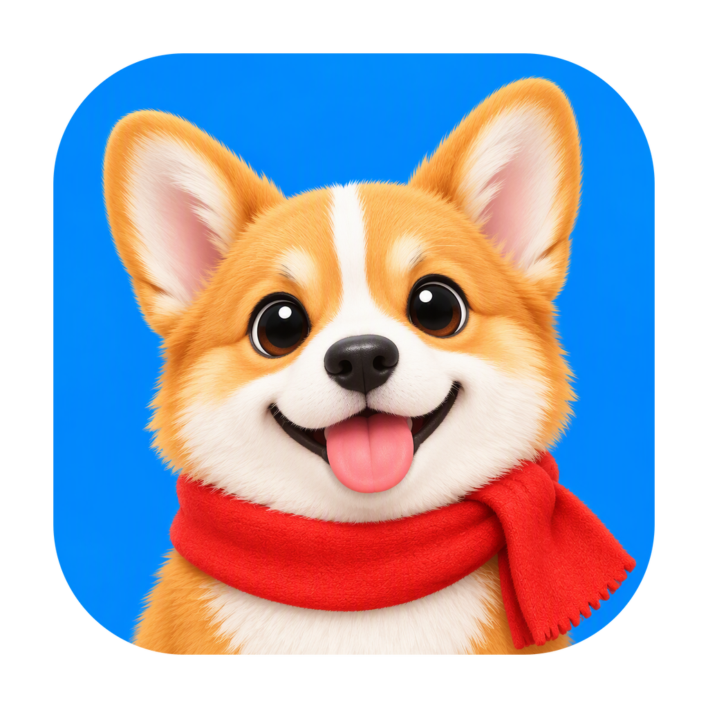

<p align="center"></p>

<h1 align="center">codedog</h1>

<p align="center">看见所有项目，最快打开它。<br>原生 macOS 应用：自动发现你电脑上的代码项目，关联 Claude Code / Codex 会话，一键续上。</p>

<p align="center"><a href="https://github.com/Howlcn1997/codedog/releases/latest">下载 macOS 版</a> · <a href="docs/user-guide.md">用户指南</a></p>

---

## 它能做什么

- **自动发现项目**：选好放代码的文件夹，codedog 自动找到里面的项目（Git、Node、Go、Python、Rust、Swift、Java 等），文件变化时增量更新。不移动、不修改任何文件。
- **今日脉搏**：一眼看到哪些项目有 AI 正在运行、哪些 AI 已经答完在等你回复、哪些还有未提交的改动、本周动过哪些。
- **AI 会话一键续上**：读取本机 Claude Code 与 Codex 的会话记录，列出每个项目最近的会话，点"续上"就在终端里接着聊（`claude --resume` / `codex resume`）。
- **活跃圆点图与用量**：近一年的提交与 AI 回复按天汇成圆点图；按模型统计 token，并按公开 API 价格估算 Claude 花费。
- **启动器**：在任何地方按 `⌘⇧Space`，输入几个字母，`↵` 用编辑器打开，`⌘↵` 续上 AI 会话，`⌥↵` 在终端打开。
- **搜索**：名称模糊匹配，也能搜标签、描述、备注、路径、依赖名和 README 正文，并告诉你命中在哪里。
- **磁盘清理**：统计每个项目的源码与依赖占用，批量把 `node_modules`、`.venv` 等可再生目录移到废纸篓（可还原）。
- **任意编辑器与终端**：Cursor、VS Code、Zed、Xcode、JetBrains 全家……或你选的任何 App；每个项目可以单独指定。
- **命令行**：`codedog open web`、`cd "$(codedog path web)"`、`codedog list lottie`。

## 安装

1. 从 [Releases](https://github.com/Howlcn1997/codedog/releases/latest) 下载 `codedog-<版本>-mac-universal.dmg`，把 codedog 拖进"应用程序"。
2. codedog 没有 Apple 开发者签名。首次打开如果提示"已损坏"或"无法验证开发者"，在终端执行：

   ```sh
   xattr -dr com.apple.quarantine /Applications/codedog.app
   ```

   只对确认来自本仓库 Releases 的应用执行这条命令。

需要 macOS 26 或更新版本，Apple 芯片与 Intel 均可。

### 从旧版（0.x，Electron）升级

直接用新版替换 `/Applications/codedog.app` 即可。首次启动会自动导入旧版的收藏、分组与标签（合并为"标签"）、备注、项目专属编辑器和全局偏好，旧数据文件 `projects.json` 只读不改。旧版的"项目组"目录会作为一个项目出现，仍然可以打开。

新版不再提供导入/移动/克隆项目、依赖安装、环境检测、导出备份等功能，原因见[重写计划](docs/swiftui-rewrite-plan.md#2-功能取舍)。

## 隐私

- 所有数据都在本机：`~/Library/Application Support/codedog/`。
- 读取但从不修改：你的代码目录、`~/.claude/projects`、`~/.codex/sessions`、VS Code 系编辑器的工作区记录。
- 唯一的网络请求是每天一次向 GitHub Releases 检查新版本（可在设置中关闭）。

## 开发

需要 Xcode 26+ 与 [XcodeGen](https://github.com/yonaskolb/XcodeGen)（`brew install xcodegen`）。

```sh
make test     # 核心库单元测试（swift test）
make run      # 生成工程、调试构建并启动
make dist     # 发布包：通用二进制、ad-hoc 签名 → release/*.dmg|zip
```

- 工程文件由 `project.yml` 生成，`codedog.xcodeproj` 不入库；用 Xcode 开发时先 `make project`。
- 调试构建默认使用 `~/Library/Application Support/codedog-dev`，不会碰到正式数据；也可以用 `CODEDOG_DATA_DIR` 指定任意目录。

### 结构

```
project.yml                 XcodeGen 工程定义（版本号唯一来源：MARKETING_VERSION）
Packages/CodedogCore/       纯逻辑：扫描、分类、Git、搜索、AI 会话、磁盘、存储（含测试）
App/                        SwiftUI 应用：主窗口、项目面板、启动器、菜单栏、设置
CLI/                        codedog 命令行（随 App 打包在 Contents/MacOS/codedog-cli）
scripts/release.sh          打包脚本
.github/workflows/          CI 与发布（推送 v* 标签自动构建并发布到 Releases）
```

### 发布

1. 修改 `project.yml` 中的 `MARKETING_VERSION` 与 `CURRENT_PROJECT_VERSION`。
2. 提交后打标签并推送：`git tag v1.0.0 && git push origin v1.0.0`。
3. GitHub Actions 校验标签与版本一致、运行测试、构建通用二进制，并把 dmg、zip 和 `SHA256SUMS.txt` 发布到 Releases。
